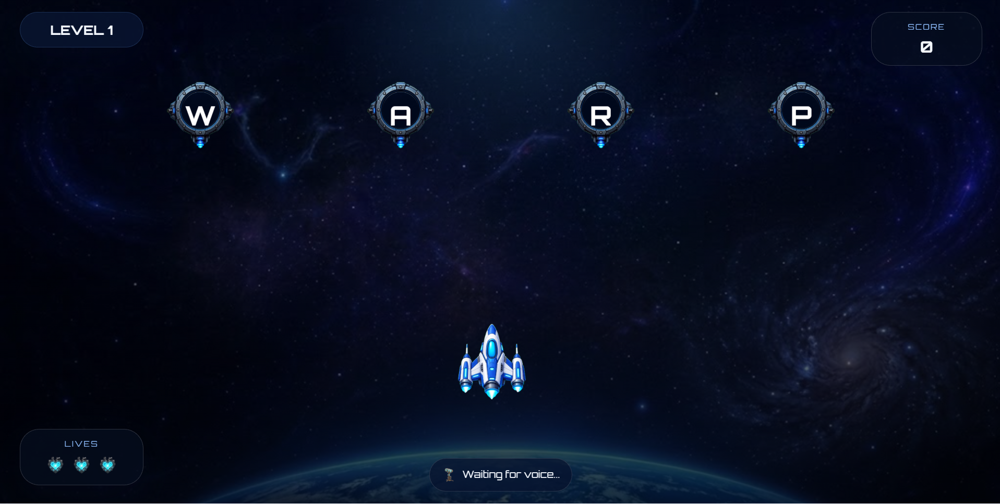

# AstroSpell

Voice-controlled spelling game. The server serves the game, **generates a new set of levels on every visit**, and logs sessions to MongoDB.



*Level 1: the player destroys each letter by saying it with the phonetic alphabet (Whiskey, Alpha, Romeo, Papa spells WARP).*
## Run it

```bash
cd server
npm install
cp .env.example .env      # then put your MongoDB connection string in .env
npm start
```

Open **http://localhost:3001** in Chrome or Edge (speech recognition needs one of them, plus an internet connection and microphone permission). Press any key or tap when the loading bar finishes.

If you already have a `server/.env`, just keep using it. The game also runs without MongoDB (levels are generated in memory); only session logging needs it.

## Levels API

`GET /api/levels` returns a fresh set of levels each time (never cached).

| Query parameter | Meaning |
| --- | --- |
| `count` | how many levels, 1-10 (default 10) |
| `seed` | integer; the same seed always returns the same levels |
| `session_id` | optional; saves which levels that session was given (`generated_levels` collection) |

Each level has two normal waves and a boss wave. Words get longer as levels go up (4 letters at level 1, up to 16 at the last boss) and no word repeats within a run. Add or remove words in `server/levels/wordBank.js`; run `npm test` (in `server/`) to check the bank and generator.

## Other endpoints

`POST /api/session`, `PATCH|POST /api/session/:id/end`, `POST /api/activity`, `POST /api/spoken-word` (now includes `expected_letter`), `POST /api/progress`, `GET /health`.

## What changed

**New:** levels come from the API instead of `data/levels.json`; press-any-key start screen (browsers block sound and speech until the first interaction); the loading screen retries if the server is unreachable.

**Fixed:**
- Letter J could not be said: "Juliet" (the spelling speech recognition returns) was missing. Also added `alfa`, `whisky`.
- The game's own prompts ("say RETRY / PROCEED / EXIT") could trigger those commands through the speakers. The microphone now ignores the game while it is speaking.
- Double letters (MOON, INTERSTELLAR...) were sometimes dropped by timing guards. Each spoken utterance is now delivered exactly once, so repeats count.
- Loading-screen exhaust trail never ran (variables used before they were declared; the error was swallowed).
- Missing `game.mp4` no longer leaves a blank background (falls back to `bg.jpeg`).
- Game-over screen no longer keeps the gameplay listener attached (it was logging stray spoken words).
- "I'm" was read as the letter I; bare "a"/"i" inside sentences are no longer treated as answers.
- Microphone permission stream is released after the permission prompt.
- Speech recognition backs off instead of retrying every 250 ms when the speech service fails.
- Logging: single end-of-session request via `sendBeacon` (was sent twice), first end time wins, relative `/api` instead of hard-coded `localhost`, input validation, clean 503 when the DB is down, deprecated Mongo options removed, only `css/`, `js/`, `assets/` and `index.html` are served (not the server source).
- Long words: enemies shrink and zig-zag over two rows so 16-letter words do not overlap.
- Removed dead files: `speechSynthesis.js`, empty `astrospell.css` / `settings.css`, unused `countdownAndNextWave`.
